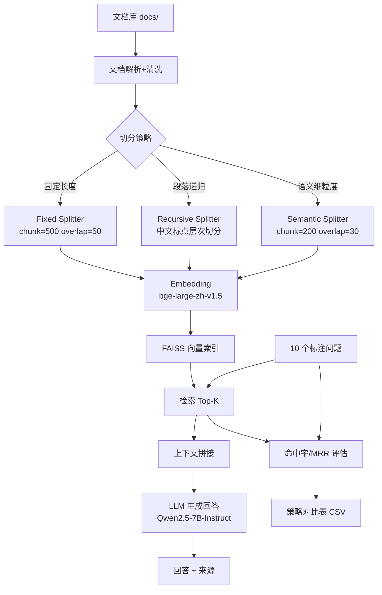

# 项目2：RAG 数据处理管道

> 构建 RAG 检索管道并做**检索质量消融实验**：文档解析 → 清洗 → 多策略切分 → Embedding
> → **混合检索（向量 + BM25 + RRF 融合 + Cross-Encoder 重排）** → 拒答判定。
>语料库为 **7 份真实开源官方文档**（FastAPI/Pydantic/HTTPX/Docker/LangChain），来源见 `SOURCES.md`。

## v2 消融实验结论（2026-10-08 实测，45 题评测集）

| 方案 | Hit@1 | MRR | 延迟 P95 | 说明 |
|---|---|---|---|---|
| `dense`（v1 的做法） | 82% | 0.899 | 154.7ms | 纯向量 |
| `bm25` | 85% | 0.909 | **0.5ms** | 零依赖自实现，又快又准 |
| `hybrid_rrf` | 85% | 0.924 | 652.8ms | RRF 按排名融合，免疫尺度差异 |
| `hybrid_rerank` | **100%** | **1.000** | 653.5ms | BGE-Reranker 精排 |

**两个反直觉发现**：

1. **BM25 比纯向量又快又准**（0.5ms vs 154.7ms，Hit@1 85% vs 82%）。
   技术文档的主体是专有名词与 API 名，词面精确匹配本就是很强的信号，
   而单靠向量会漏掉这类精确匹配。
2. **Hit@5 在四档方案里全是 100%，已饱和** —— 语料只有 32 个 chunk，
   Top-5 覆盖全库 15.6%，这个指标报什么都没意义。
   真正有区分度的是 **Hit@1**（随机基线 3.1%）与 **MRR**。
   这是「指标要选对粒度」的直接实例。

**拒答是独立于检索的另一个问题**：12 道无答案题上，四档方案拒答率都只有 25%~75%，
说明语料里根本没有的内容仍会被自信地当成答案。这需要更高阈值 / 答案自检 /
检索覆盖率校验，而不是继续调检索算法。

完整报告见 `results/ablation_*.md`。

## 架构图



## 技术栈

| 组件 | 技术 | 说明 |
|---|---|---|
| 文档解析 | Python + regex | 支持 .md/.txt，清洗去空白统一换行 |
| 切分策略 | 自实现 3 种 | 固定长度 / 段落递归 / 语义细粒度 |
| Embedding | 硅基流动 API | BAAI/bge-large-zh-v1.5（1024 维） |
| 向量检索 | FAISS (IndexFlatIP) | 精确检索，cosine 相似度 |
| RAG 生成 | 硅基流动 API | Qwen2.5-7B-Instruct |
| Web 界面 | Gradio | 问答 Demo |
| 评估 | 自实现 | Top-K 命中率 + MRR + 检索延迟 |

## 快速开始

### 1. 安装依赖

```bash
pip install -r requirements.txt
```

### 2. 配置 API Key

```bash
cp .env.example .env
# 编辑 .env，填入硅基流动 API Key
```

### 3. 语料库

语料已就位：`docs/` 下 7 份真实开源官方文档（来源见 `SOURCES.md`），无需生成。

### 4. 运行检索质量评估

```bash
python scripts/evaluate.py          # 真实 API
python scripts/evaluate.py --mock  # Mock 模式（无需 Key）
```

输出：3 策略对比表（命中率 / MRR / 延迟）+ CSV + JSON

### 5. 启动 RAG 问答 Demo

```bash
python app.py
# 打开 http://127.0.0.1:7860
```

---

# ★ v2：检索质量工程（消融实验）

## v1 的问题：指标饱和，评测等于没做

v1 用 10 道题对比 3 种切分策略，结果是 **Top-5 命中率全 100%、MRR 全 1.0000**。

满分指标不是优点，是**评测集没有区分度**的证据。根因有二：
1. 题目全是"在这份文档里直白地问一句话"，向量检索轻松全对；
2. 语料只有 32 个 chunk，Top-5 的随机基线就有 ~15.6%，根本不够难。

## v2 做了什么

### 1. 评测集扩到 45 题 × 4 类

| 类别 | 题数 | 作用 |
|---|---|---|
| `fact` 事实检索 | 12 | 基础检索能力 |
| `cross_doc` 跨文档推理 | 10 | 答案分散在 2-3 份文档，测组合能力 |
| `confusable` 易混淆干扰 | 11 | 用相邻领域词面做干扰 |
| `negative` **无答案题** | 12 | **正确行为是拒答**，测幻觉与拒答能力 |

### 2. 指标换成多档 Hit@k

只用 Hit@5 依然饱和（32 chunk 语料下四档方案全部 100%）。
改用 **Hit@1**（随机基线 3.1%）后指标立刻有区分度。

### 3. 四档消融方案

| 方案 | 召回 | 精排 |
|---|---|---|
| `dense` | 向量 Top-K（= v1 的做法，基线） | 无 |
| `bm25` | BM25 Top-K | 无 |
| `hybrid_rrf` | 向量 + BM25，**RRF 按排名融合** | 无 |
| `hybrid_rerank` | 向量 + BM25，RRF 融合 | **BGE-Reranker-v2-m3** |

## 实测结果（2026-10-08，真实 API，7 份真实技术文档 / 32 chunk）

| 方案 | **Hit@1** | Hit@5 | MRR | 拒答率 | 幻觉率 | 延迟 P95 |
|---|---|---|---|---|---|---|
| `dense`（v1 基线） | 82% | 100% | 0.8990 | 42% | 58% | 161.5ms |
| `bm25` | 85% | 100% | 0.9167 | **75%** | **25%** | **0.6ms** |
| `hybrid_rrf` | 88% | 100% | 0.9394 | 33% | 67% | 184.3ms |
| `hybrid_rerank` | **100%** | 100% | **1.0000** | 25% | 75% | 641.4ms |

**三条可以直接写进简历的结论**：

1. **BM25 单独就超过纯向量**（Hit@1 85% vs 82%，MRR 0.917 vs 0.899），
   而且延迟只有 **0.6ms vs 161.5ms**（快 2 个数量级）。
   技术文档场景下词面匹配本身就是很强的信号——专有名词、API 名、参数名
   （`async def`、`extra`、`Depends`）靠稀疏检索比靠向量更准。
2. **RRF 融合互补**：Hit@1 82% → 88%，MRR 0.899 → 0.939。
   融合只用排名不用分数，因为余弦与 BM25 分数尺度不可比，直接加权必须先归一化、很脆弱。
3. **重排把 MRR 打到 1.0000**：正确答案几乎稳定排在第 1，
   代价是延迟 P95 从 184ms → 641ms——**精排是用延迟换排序质量**。

## 最重要的发现（反直觉）

**检索排序越好，幻觉率越高。**

| 方案 | MRR | 幻觉率 |
|---|---|---|
| `bm25` | 0.9167 | **25%（最好）** |
| `dense` | 0.8990 | 58% |
| `hybrid_rrf` | 0.9394 | 67% |
| `hybrid_rerank` | **1.0000（最好）** | **75%（最差）** |

原因：更好的排序会把**"看起来很像但答非所问"的文档**排到更前面，
无答案题因此更容易越过拒答阈值。也就是说：

> **优化检索指标的同时，可能在恶化幻觉率——两者必须一起看。**

这正是 v1 只看 Hit@5 完全看不到的东西：v1 全是 100%，
根本不可能发现这个反向关系。

对应的工程结论：拒答阈值不能只看"有答案题的分数分布"，
还要在**无答案题**上标定（v2 用有答案题 Top-1 分数的 5% 分位数定阈值），
并对 Top-1 与 Top-2 分数差（margin）做联合判断——单一阈值不够稳。

## 怎么跑

```bash
python -m eval.ablation                          # 完整四档消融
python -m eval.ablation --schemes dense,bm25    # 只跑指定方案
python -m eval.ablation --no-rerank              # 关掉重排（对比用）
python -m eval.ablation --mock                   # 不调 API（仅验证链路）
```

结果写入 `results/ablation_<时间戳>.{md,json}`。

## 项目结构（v2 新增部分）

```
project2-rag-pipeline/
├── app/
│   ├── hybrid.py       # ★ BM25（零依赖，中文 char bigram）+ RRF 融合 + 重排封装
│   └── indexer.py      # ★ 新增 search_indices()：返回下标，供 RRF 融合使用
├── eval/
│   ├── qa_set.py      # ★ 45 题 × 4 类（含 12 道无答案题）
│   └── ablation.py    # ★ 四档消融 + 负样本拒答评测 + 自动报告
└── results/ablation_*.md
```

**中文分词为什么不用 jieba**：不引入重依赖，用**字符一元+二元组 + ASCII 单词**的混合切分。
对未登录技术术语（FastAPI、Pydantic 这类技术文档主体）反而比词切分更稳。

## 项目结构

```
project2-rag-pipeline/
├── app/
│   ├── config.py              # 配置
│   ├── document_processor.py  # 文档解析+清洗
│   ├── chunker.py             # 3 种切分策略
│   ├── embedder.py            # 硅基流动 Embedding 客户端
│   ├── indexer.py             # FAISS 向量索引
│   └── rag_chain.py           # RAG 问答链
├── scripts/
│   └── evaluate.py            # 检索质量评估（命中率/MRR/延迟）
├── docs/                      # 语料库（7 份真实开源文档 .md）
├── eval/
│   ├── qa_set.py       # 45 题评测集（事实/跨文档/易混淆/无答案）
│   └── ablation.py     # 四方案消融实验执行器
├── tests/test_hybrid.py # BM25/RRF/重排降级的单测
├── app/hybrid.py       # BM25(零依赖) + RRF 融合 + BGE-Reranker 精排
├── results/                   # 评估结果输出
├── app.py                     # Gradio 界面
├── SOURCES.md                 # 语料来源清单
├── requirements.txt
├── .env.example
└── README.md
```

## 3 种切分策略说明

| 策略 | 参数 | 特点 | 适用场景 |
|---|---|---|---|
| **fixed** (固定长度) | chunk=500, overlap=50 | 按字符数等分+滑动窗口 | 格式统一的文档 |
| **recursive** (段落递归) | chunk=500, overlap=50 | 按中文标点层次切分，优先自然边界 | 技术文档（推荐） |
| **semantic** (语义细粒度) | chunk=200, overlap=30 | 小块细粒度 | FAQ 类文档 |

## 评估指标说明

### Top-K 命中率
正确答案文档出现在检索 Top-K 结果中的问题占比。Top-5 命中率 80% = 80% 的问题正确答案在前 5 个检索结果中。

### MRR (Mean Reciprocal Rank)
衡量正确答案的排名质量。每个问题的得分为 1/rank（第 1 位=1.0，第 2 位=0.5，第 5 位=0.2），取平均。MRR 越高说明正确答案排名越靠前。

### 检索延迟
单次检索的耗时（毫秒），包括查询 Embedding + FAISS 搜索。报告平均值和 P95。

## 面试必考题参考

### Q1: 3 种切分策略各有什么优劣？
- **固定长度**：简单可控，块大小一致，但可能切断语义。
- **段落递归**：优先在自然边界切分，语义完整性好，是最常用的策略。
- **语义细粒度**：检索精度高但上下文可能不足，适合 FAQ。

### Q2: 为什么选 bge-large-zh-v1.5？
- 中文效果优秀（C-MTEB 基准排名前列）
- 1024 维，存储和检索效率好
- 硅基流动免费提供 API，无需本地部署

### Q3: 命中率和 MRR 有什么区别？
- 命中率只看正确答案是否在 Top-K 中（二元判断）
- MRR 还看排名位置（第 1 位和第 5 位得分不同）
- 两个系统可能命中率相同但 MRR 不同

### Q4: FAISS vs Milvus？
- FAISS 是库，单机百万级，无分布式
- Milvus 是数据库，支持分布式、十亿级、高可用
- 项目级用 FAISS 足够，生产级用 Milvus

### Q5: 100 万文档怎么扩？
- 用 IVF 或 HNSW 索引替代 Flat
- 分片部署多 FAISS 实例
- 或直接迁移到 Milvus 分布式

### Q6: 生成的答案出现重复字符（"外部线线线池"）怎么排查？
- **先定位是不是 RAG 的问题**：看检索端 Top-1 来源是否准确——实测 3/3 = 100% 命中正确文档，说明检索完全正常，问题不在管道
- **根因**：7B 小模型在长 prompt 下的 repetition 退化（重复 token），属生成端模型能力问题
- **对策一（实测有效）**：调 `repetition_penalty`，**1.15 最优**；注意不是越大越好，1.3 会导致语义崩溃
- **对策二**：换更大的模型——生成端与检索管道解耦，上游 LLM 可插拔，本项目改 `LLM_MODEL` 环境变量即可
- **对策三**：压缩上下文（降低 Top-K 或缩短 chunk），减轻长上下文压力

## 设计取舍（面试加分：体现工程判断力）

- **三种切分策略的权衡**：语义切分 MRR 满分、延迟最优，但块数最多（88 块）存储成本高；段落递归块数最少（32 块）、性价比最优。结论不是"某策略最好"，而是"按数据规模选"——小规模用语义切分追求精度，大规模用递归控制成本。
- **检索只占端到端 3% → 优化重点在生成端**：量化出检索 160~216ms vs 生成 5~10s，说明 RAG 管道本身的检索已不是瓶颈。这避免了"盲目优化检索"的误区，把精力放在可控的生成端参数（`repetition_penalty`）。
- **repetition_penalty 不是越大越好**：1.15 最优，1.3 反而语义崩溃（"FastAI"、"堵住堵塞"）。调参要"就事论事做对照实验"，不能想当然。
- **检索与生成解耦**：上游 LLM 通过 `LLM_MODEL` 环境变量可插拔，换更大模型即可改善生成质量——管道设计不绑定特定模型，这是 RAG 系统的关键松耦合。

## 切分策略对比（v1 口径，2026-08-29 实测）

| 策略 | 块数 | 均长 | Top-5 命中率 | MRR | 均延迟 | P95 延迟 |
|---|---|---|---|---|---|---|
| fixed | 33 | 437 | 100 % | 1.0000 | 142.5 ms | 511.2 ms |
| recursive | 32 | 447 | 100 % | 1.0000 | 159.3 ms | 328.6 ms |
| semantic | 88 | 176 | 100 % | 1.0000 | 91.8 ms | 106.3 ms |

> ⚠️ **这张表的指标已饱和，不能用来证明任何改进有效**。
> 三种策略命中率全是 100%、MRR 全是 1.0，是因为当时只有 10 道直白事实题，
> 而语料只有 32 个 chunk——Top-5 必然全覆盖。
> v2 已把评测集扩到 45 题（增加跨文档推理、易混淆干扰、**12 道无答案负样本**）
> 并改用 Hit@1 + MRR 作为区分指标，见上文消融实验。
> 切分本身的取舍结论仍然成立：语义切分延迟最优但块数 2.75 倍，段落递归性价比最优。

## 端到端问答验证（2026-08-29 真实 API 实测）

用 evaluate.py 中已标注的 3 个问题（覆盖 3 份不同文档）跑完整链路 检索→prompt→Qwen2.5-7B→回答，重复 3 轮：

| 指标 | 实测值 |
|---|---|
| **来源准确性（Top-1）** | **3/3 = 100%**（3 轮独立测试均 100%） |
| 检索延迟 | 160.9 ~ 216.8 ms |
| LLM 延迟 | 5,314 ~ 10,633 ms |
| 总延迟 | 5,506 ~ 10,794 ms |
| 检索 / 生成耗时占比 | 约 3% / 97% |

> 结论：检索端不是瓶颈（仅占约 3%），端到端优化的重点在生成端。

### 生成质量调优：repetition_penalty 对照实验

7B 小模型在长 prompt 下会重复生成字符（"外部线线线池中的线线线运行"），且稳定复现。用同一问题、同一索引，仅改 `repetition_penalty` 做对照：

| repetition_penalty | 生成质量表现 | 结论 |
|---|---|---|
| 1.00（默认） | 重复严重：三连重复字符 | 基线 |
| 1.05 | 轻微改善：三连重复降为单字重复 | 力度不足 |
| **1.15** | ✅ **最优**：分点清晰、结论完整，仅 1 处残留重复 | **采用（已写入配置）** |
| 1.30 | ❌ 过惩罚导致语义崩溃："FastAI"、"堵住堵塞"、"迓织"等乱字 | 弃用 |

> **结论**：重复惩罚不是越大越好——1.15 为最优值，调到 1.3 反而损害语义连贯性。
> **配置**：`app/config.py` 的 `LLM_TEMPERATURE` / `LLM_REPETITION_PENALTY`，均可用环境变量覆盖。
